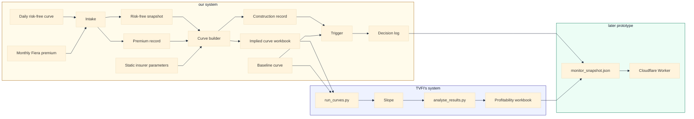

# Daily monitor flow

Working diagram for the architecture in `Project Architect/architecture.md`. Not a TVFI deliverable.

The cream box is our system. The blue box is TVFI's system. The green box is the later dashboard prototype. Arrows enter those boxes from the side, under the titles. The saved picture is `data-flow.png`.

